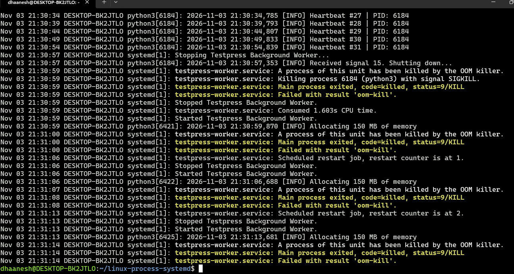

# Linux Process Management & systemd – Experiments
All experiments were executed in Ubuntu 22.04 running under WSL.

---

## Experiment 1: Running Process

### Action

Started the systemd-managed Python worker and inspected its process information.

**Command executed:**

```bash
PID=$(systemctl show testpress-worker -p MainPID --value)
ps -p "$PID" -o pid,ppid,user,stat,cmd
```

### Observation

The output showed:

```text
PID   PPID USER       STAT CMD
225   1    testpre+   Ss   /usr/bin/python3 /opt/testpress-worker/app.py
```

The Python application was running with PID `225` and PPID `1`, under the dedicated `testpress-worker` user.

### Explanation

Linux assigns every running process a unique Process ID (PID).

The PPID identifies the parent process. Here, PID 1 is systemd, which manages the service process.

This confirms that our Python application is running as a systemd-managed background process rather than under the current terminal session.

### Evidence


---

## Experiment 2: Graceful Shutdown using SIGTERM

### Action

Created and executed a separate Python process using `demo_process.py`.

**Commands executed:**

```bash
python3 demo_process.py > worker.log 2>&1 &
cat worker.log

kill -15 2748

cat worker.log
```

### Observation

The process started with PID `2748`.

The log showed:

```text
Demo process started. PID: 2748
Heartbeat...
Heartbeat...
Heartbeat...
```

After sending SIGTERM, the shell reported:

```text
[1]+ Terminated python3 demo_process.py > worker.log 2>&1
```

The process was no longer found by `pgrep`.

**Note:** The captured screenshot shows process termination, but it does not show the application's `Received signal 15` or graceful shutdown message. The shutdown handler should be verified separately if this screenshot is used as proof of graceful handling.

### Explanation

SIGTERM (signal 15) requests a process to terminate.

An application can register a signal handler to perform cleanup before exiting. Unlike SIGKILL, SIGTERM can be handled by the application.

### Evidence


---

## Experiment 3: Forced Termination using SIGKILL

### Action

Started the Python demo process in the background and sent SIGKILL.

**Commands executed:**

```bash
python3 demo_process.py > worker.log 2>&1 &

cat worker.log

kill -9 2933

cat worker.log
```

### Observation

The process started with PID `2933`.

After sending SIGKILL, the shell reported:

```text
[1]+ Killed python3 demo_process.py > worker.log 2>&1
```

The process was immediately terminated.

### Explanation

SIGKILL (signal 9) forcefully terminates a process.

The application cannot catch or handle SIGKILL. Therefore, it cannot perform graceful cleanup before termination.

This demonstrates the difference between SIGTERM and SIGKILL.

### Evidence


---

## Experiment 4: Running Application as a systemd Service

### Action

Started the Python application using systemd and inspected its status.

**Command executed:**

```bash
sudo systemctl status testpress-worker
```

### Observation

The output showed:

```text
Loaded: loaded (/etc/systemd/system/testpress-worker.service;
                enabled; vendor preset: enabled)

Active: active (running)

Main PID: 225 (python3)

Memory: 4.7M (max: 100.0M swap max: 0B)
```

The application was running successfully under the dedicated `testpress-worker` user.

### Explanation

systemd manages the application as a service.

The service runs in the background, independently of the terminal session. It also provides automatic restart, logging, resource limits and startup management.

The `active (running)` state confirms that the service is currently running.

### Evidence


---

## Experiment 5: Automatic Restart after Unexpected Failure

### Action

Captured the current process PID, forcefully terminated it and checked whether systemd restarted the application.

**Commands executed:**

```bash
PID_BEFORE=$(systemctl show testpress-worker -p MainPID --value)

echo "PID before crash: $PID_BEFORE"

sudo kill -9 "$PID_BEFORE"

sleep 7

PID_AFTER=$(systemctl show testpress-worker -p MainPID --value)

echo "PID after restart: $PID_AFTER"
```

### Observation

The output showed:

```text
PID before crash: 225
PID after restart: 1919
```

The process received a new PID after the unexpected termination.

The service became active again.

### Explanation

The service is configured with:

```ini
Restart=on-failure
RestartSec=5
```

When the application is unexpectedly terminated by SIGKILL, systemd identifies the failure and starts a new process after the configured delay.

The new process receives a different PID.

### Evidence


---

## Experiment 6: Investigating Service Crashes using journald

### Action

Used journalctl to inspect the service logs and investigate the unexpected termination.

**Command executed:**

```bash
sudo journalctl -u testpress-worker --since "1 minutes ago" --no-pager
```

### Observation

The logs showed:

```text
Main process exited, code=killed, status=9/KILL

Failed with result 'signal'.

Scheduled restart job, restart counter is at 2.

Stopped Testpress Background Worker.

Started Testpress Background Worker.
```

A new Python process started with PID `3199`.

### Explanation

systemd records service events and application output in the system journal.

The logs help identify:

- Why the process exited.
- Which signal terminated it.
- Whether the service failed.
- Whether systemd attempted a restart.

`journalctl -u` filters logs for a particular service, making it easier to investigate failures.

### Evidence


---

## Experiment 7: Invalid Executable Configuration

### Action

Intentionally configured an invalid Python executable path in the systemd service file.

Changed:

```ini
ExecStart=/usr/bin/python3 /opt/testpress-worker/app.py
```

To:

```ini
ExecStart=/usr/bin/python-invalid /opt/testpress-worker/app.py
```

Reloaded systemd and attempted to start the service.

**Commands executed:**

```bash
sudo systemctl daemon-reload
sudo systemctl stop testpress-worker
sudo systemctl reset-failed testpress-worker
sudo systemctl start testpress-worker

sudo systemctl status testpress-worker

sudo journalctl -u testpress-worker -n 25 --no-pager
```

### Observation

The logs showed:

```text
Failed to locate executable /usr/bin/python-invalid:
No such file or directory

Failed at step EXEC spawning /usr/bin/python-invalid

Main process exited, code=exited, status=203/EXEC

Failed with result 'exit-code'
```

The service failed to start because the configured executable did not exist.

### Explanation

systemd attempts to execute the command specified in `ExecStart`.

Since the executable path was invalid, systemd could not launch the Python application.

Exit status `203/EXEC` indicates that systemd failed while executing the configured command.

This is a configuration problem, not an application-level Python error.

### Evidence


---

## Experiment 8: Repeated Crashes and Restart Rate Limiting

### Action

Configured the application to crash immediately after its first heartbeat.

Updated the environment file:

```ini
WORKER_NAME=testpress-worker
CRASH_AFTER=1
ALLOCATE_MB=0
```

The service was configured with:

```ini
StartLimitIntervalSec=30
StartLimitBurst=3

Restart=on-failure
RestartSec=5
```

**Commands executed:**

```bash
sudo systemctl stop testpress-worker
sudo systemctl reset-failed testpress-worker
sudo systemctl start testpress-worker

sudo systemctl status testpress-worker

sudo journalctl -u testpress-worker -n 40 --no-pager
```

### Observation

The application repeatedly crashed with exit status `1`.

The journal showed:

```text
Simulating application crash!

Main process exited, code=exited, status=1/FAILURE

Failed with result 'exit-code'.

Scheduled restart job, restart counter is at 1.
```

After repeated failures:

```text
Scheduled restart job, restart counter is at 3.

Start request repeated too quickly.

Failed to start Testpress Background Worker.
```

### Explanation

systemd automatically restarts the application because `Restart=on-failure` is configured.

However, continuously restarting a failing application is not useful.

`StartLimitIntervalSec=30` defines the time window for counting start attempts.

`StartLimitBurst=3` allows a maximum of three starts within that window. Once the limit is reached, systemd refuses further start attempts until the failure state is reset or the rate-limit window expires.

This prevents a continuously crashing service from restarting indefinitely at a high frequency.

### Evidence


---

## Experiment 9: CPU and Memory Resource Limits

### Action

Configured resource limits in the systemd service file.

```ini
CPUQuota=20%
MemoryMax=100M
MemorySwapMax=0
```

Added an optional memory allocation test to the Python application using the `ALLOCATE_MB` environment variable.

Configured:

```ini
ALLOCATE_MB=150
```

The application allocated 150 MB and wrote to each 4 KB memory page to ensure the memory was actually used.

**Commands executed:**

```bash
sudo systemctl daemon-reload

sudo systemctl stop testpress-worker
sudo systemctl reset-failed testpress-worker
sudo systemctl start testpress-worker

sleep 10

sudo systemctl status testpress-worker

sudo journalctl -u testpress-worker -n 40 --no-pager
```

### Observation

The application attempted to allocate 150 MB while the service had a 100 MiB memory limit.

The journal showed:

```text
Allocating 150 MB of memory

A process of this unit has been killed by the OOM killer.

Main process exited, code=killed, status=9/KILL

Failed with result 'oom-kill'.
```

systemd attempted to restart the application, but the new process also exceeded the memory limit and was killed.

### Explanation

systemd uses Linux cgroups to enforce resource limits on services.

`CPUQuota=20%` limits the service to 20% of one CPU core.

`MemoryMax=100M` sets the maximum memory limit for the service.

Initially, the process was able to use swap memory, so it did not get killed immediately. Setting `MemorySwapMax=0` disabled swap usage for the service.

When the application exceeded its memory limit, the kernel's OOM killer terminated it.

systemd detected the OOM kill and reported `oom-kill` as the failure reason.

This demonstrates how systemd can protect a server from an application consuming excessive memory.

### Evidence



---

## Experiment 10: Reboot Persistence

### Action

Enabled the service to start automatically during system startup.

**Commands executed inside Ubuntu:**

```bash
sudo systemctl enable testpress-worker
sudo systemctl start testpress-worker

systemctl is-enabled testpress-worker
systemctl is-active testpress-worker

uptime -s
```

Restarted the Ubuntu WSL distribution from Windows PowerShell.

**Commands executed in PowerShell:**

```powershell
wsl --list --verbose

wsl --terminate Ubuntu-22.04
```

Started Ubuntu again and checked the service status.

**Commands executed after restarting Ubuntu:**

```bash
uptime -s

systemctl is-enabled testpress-worker

systemctl status testpress-worker
```

### Observation

After restarting WSL, the output showed:

```text
enabled

Active: active (running)

Main PID: 225 (python3)
```

The service was running without manually executing `systemctl start`.

The boot time was:

```text
2026-11-03 20:08:34
```

### Explanation

`systemctl enable` configures a service to start automatically when its configured systemd target is reached during startup.

It creates the necessary symlink under the systemd target's wants directory.

Since the service was enabled, systemd started it automatically when Ubuntu started again.

This experiment verifies automatic service startup after restarting the WSL Linux environment.

Note: This verifies WSL distribution restart persistence, not a physical server reboot.

### Evidence


---

## Conclusion

Through these experiments, I learned how Linux manages processes and how systemd manages long-running applications.

I demonstrated:

- Inspecting and managing Linux processes.
- Understanding SIGTERM and SIGKILL.
- Running a Python application as a systemd service under a dedicated non-root user.
- Automatically restarting applications after unexpected failures.
- Investigating service failures using journald.
- Understanding systemd restart rate limiting.
- Configuring CPU and memory limits using systemd.
- Observing how the OOM killer terminates processes that exceed memory limits.
- Enabling services to start automatically when the Linux environment starts.

These concepts are directly applicable to managing long-running applications such as Django services, Celery workers and other background processing services in production environments.
